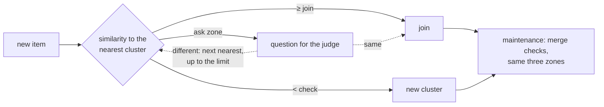

# Concepts

This page explains how Akinly decides, and why. It describes behavior; [Configuration](configuration.md) lists the options that tune it, and [the design record](design.md) keeps the decisions and their reasons.

- [Items](#items)
- [Clusters and their lasting ids](#clusters-and-their-lasting-ids)
- [Centroids from sums](#centroids-from-sums)
- [The three zones](#the-three-zones)
- [Questions](#questions)
- [Verdicts](#verdicts)
- [Refusals](#refusals)
- [Precision or recall](#precision-or-recall)
- [The criterion](#the-criterion)
- [Waiting items](#waiting-items)
- [Merges](#merges)
- [Splits](#splits)
- [Maintenance](#maintenance)
- [Labels](#labels)
- [Texts](#texts)
- [The store and its change sets](#the-store-and-its-change-sets)
- [One writer](#one-writer)
- [Determinism](#determinism)
- [Three layers](#three-layers)

## Items

An item is one short text, known to Akinly by **your id** for it (a string) and its **embedding** (`ClusterItem(string Id, ReadOnlyMemory<float> Embedding)`). Ids must be unique in a store; adding an id that is already there throws, so to change an item, remove it and add it again.

Embeddings are compared by direction only: Akinly normalizes them to unit length, and similarity is the cosine of the angle between two of them. Every embedding in a store has the same length, and a zero vector or one holding a NaN or an infinity is refused.

The core never sees an item's text. It is read only when a judge or a labeler needs it for a prompt; see [Texts](#texts).

## Clusters and their lasting ids

A cluster is a group of items that say the same thing. It has:

- an **id**, a `long` handed out by the store in order (1, 2, 3, ...) and never reused;
- a **centroid**, the mean direction of its members' embeddings, unit length;
- a **count** of members;
- an optional **label**, a one-sentence title, and the count it had when the label was set (`LabeledAtCount`).

Ids last: a cluster can be stored, linked to and shown on a page, and an item that arrives months later joins it again. When two clusters merge, the surviving cluster keeps its id and the other id redirects to it, so old links still resolve (`GetClusterAsync` and `GetMembersAsync` follow the redirect). When a cluster loses all its members, it keeps its id and its last centroid, and a returning item can join it again at the join threshold.

## Centroids from sums

Each cluster keeps the sum of its members' unit-length embeddings in double precision, and its centroid is the direction of that sum. So the centroid is the true mean direction, up to rounding, whatever order items arrived in. A merge adds two sums and a removal subtracts one, so neither moves the centroid anywhere a fresh computation would not. After 16 removals from one cluster, maintenance recomputes its sum from the members, so rounding cannot build up.

## The three zones

When an item arrives, the clusterer fetches its `CandidateClusters` (10) nearest clusters from the store. Its similarity to the nearest one decides what happens:

| Zone | Similarity to the nearest cluster | What happens |
|---|---|---|
| Join | At or above `JoinSimilarity` (0.83) | The item joins without a question |
| Ask | From `CheckSimilarity` (0.30) up to the join threshold | A question goes to a judge; the item waits for the answer |
| New | Below `CheckSimilarity` | The item starts a cluster of its own |



Why three zones: embeddings capture topic well and the exact meaning only roughly. Above some similarity, two texts almost always say the same thing; below another, they almost never do. Between the two, texts about the same topic and texts about the same specific problem look alike to the embedding. That band is where a judge, which reads the texts, earns its cost; everywhere else similarity is enough and free.

Set `CheckSimilarity` equal to `JoinSimilarity` and the ask zone disappears: that is cosine-only clustering, with no judge needed (`ClusteringOptions.CosineOnly` does it for joins and merges at once).

The thresholds are cosine similarities and depend on the embedding model: two models do not put the same pair of texts at the same similarity. The defaults were calibrated for OpenAI's `text-embedding-3-small` on public intent datasets (see [Configuration](configuration.md#thresholds)). For another model, [calibrate them](how-to/calibrate-thresholds.md).

The default ask zone is wide on purpose: the judge, not similarity, decides the close calls, and `MaxChecksPerItem` bounds how many questions one item can cost.

An empty cluster (all its members removed) takes a returning item only at the join threshold: with no members to show, a judge would have nothing to compare.

## Questions

A question is a record the clusterer hands back when similarity cannot decide. There are two kinds:

| Kind | Asks | Carries |
|---|---|---|
| `JoinQuestion` | Which of these clusters, if any, does this item belong in? | `ItemId`, `ClusterId` (the nearest), `Similarity`, `ClusterLabel`, `ExampleItemIds` (up to `ExamplesPerQuestion`, 10, members nearest the centroid, nearest first), and `OtherChoices`: the next nearest clusters, each a `JoinChoice(ClusterId, Similarity, ClusterLabel, ExampleItemIds)` |
| `MergeQuestion` | Are these two clusters one? | `ClusterId`, `OtherClusterId`, `Similarity` of the two clusters (by default the average similarity of their members, `MergeLinkage`), both labels, `ExampleItemIds` and `OtherExampleItemIds` (up to `MergeExamplesPerCluster`, 8, each) |

Every question has an `Id` (a `QuestionId` wrapping a `long`), handed out in order by the store. A question carries everything a judge needs except the texts, so it can be answered later, elsewhere, or in a provider's batch: store the questions, and pass the answers to `AnswerAsync` whenever they arrive. The judge looks up the texts by id. Why examples rather than the whole cluster: in the measurements behind the design (on private data, see [the design record](design.md#what-we-know-already)), the label and the ten members nearest the center served a judge as well as the whole cluster, at a fraction of the tokens.

A join question offers up to `JoinChoices` (3) clusters, nearest first, among the clusters with members that have not refused the item, and never more than the checks the item has left. A cluster with neither examples nor a label to show is left out. The nearest must be at or above `CheckSimilarity`; the others are offered with it whatever their similarity, as context. Shown its neighbors side by side, a judge sees how fine the clusters are, and can tell "the same thing" from "a related thing" better than when it sees one cluster alone. With `JoinChoices` set to 1, or when only one cluster is near, `OtherChoices` is empty and the question is a plain yes or no. Picking a cluster offered as context joins it whatever its similarity, and a "none" refuses it like the others.

`AddAsync` and `AnswerAsync` return the questions they asked in their `ClusteringStep`; `GetOpenQuestionsAsync` returns every question still waiting.

## Verdicts

An answer is a `Verdict(QuestionId, VerdictKind)`. There are four kinds:

| Kind | Meaning | For a join question | For a merge question |
|---|---|---|---|
| `Same` | The same thing | The item joins the question's `ClusterId` (`PlacementReason.Judge`), or the cluster picked with `Verdict.Picked` | The clusters merge, if they are still close (below) |
| `Different` | Different things | Every cluster offered refused the item; the next nearest cluster that has not refused it is tried | The pair is recorded as different and never merged, not even by similarity |
| `Failed` | No answer this time (a timeout, an outage, an unreadable answer) | The question stays open and is asked again | The same |
| `Unanswerable` | No answer is possible (an item's text is gone) | The question closes; similarity alone decides for the item from now on | The pair is recorded and not asked again; a certain merge (at or above `MergeSimilarity`) can still join it |

To answer a question with choices, pick one cluster with `Verdict.Picked(questionId, clusterId)`: its `PickedClusterId` property names the cluster, the question's own `ClusterId` or one from `OtherChoices`. `Verdict.Same` picks the question's own `ClusterId`, and `Verdict.Different` means none of them. A pick of a cluster that was not offered counts as a `Failed` answer.

A failure is never a refusal. After `FailedAnswers.MaxAttempts` (3) failures, a join question closes and the item is placed by similarity alone: it joins its nearest cluster at the join threshold and starts its own below it. A merge question closes without recording anything, so the pair is asked about again once either cluster changes. An outage therefore delays placement and may leave more, smaller clusters; it never records "different" answers that would keep clusters apart for good.

Rules the clusterer keeps for answers:

- **Applied once.** An answer to an unknown or closed question is ignored, and only the first answer to a question counts. Answers can arrive late, out of order, or twice.
- **Ordered within a call.** The answers passed to one `AnswerAsync` call are applied in question order, whatever order they are listed in.
- **A late yes is checked.** A merge answered `Same` is applied only if the two clusters are still within the merge-check zone. A join answered `Same` (or a cluster picked) that has since merged into another goes to the survivor only if the item is within the check zone of it and no cluster that refused the item merged into it; otherwise the item is placed again.

## Refusals

When a judge answers `Different` to a join question, every cluster the question offered has **refused** the item: the nearest, and each of `OtherChoices`. The item is then compared with its next nearest cluster that has not refused it: it may join it by similarity, be asked about it, or start a cluster of its own. Each refusal counts toward `MaxChecksPerItem` (3), so a "none" to a question that offered three clusters counts three. Once an item has that many refusals, it is asked no more, and joins a cluster only at the join threshold. With the defaults, an item costs at most one join question when each offers three clusters, and up to three when each offers one.

Refusals last and follow merges: an item never joins, and is never asked about, a cluster that refused it, even after that cluster merged into another. A refusal is not lifted when the item is later removed.

A refusal also bears on merges, as `MergeRefusals` says. When one cluster refused an item that is now in the other, merging them would carry the item into a cluster that said no to it. One item's refusal says little about whether two whole clusters are the same, though, and a "none" to three choices refuses all three. So by default (`RefusalRule.Ask`) such a pair is never merged on similarity alone, and a judge decides. `RefusalRule.Block` keeps it apart for good, as 1.0 did; on texts written to one template that left many near-identical clusters that were never even asked about. `RefusalRule.Ignore` merges it like any other pair.

## Precision or recall

On a close call a judge can be wrong two ways: keep apart two things that are the same (lower recall, duplicates left split), or put together two that are not (lower precision, mixed clusters). `ChatClientJudgeOptions.Preference` (`ClusteringPreference`) says which mistake the model should rather make:

| Preference | Tie-break added to the prompt | Clusters |
|---|---|---|
| `Balanced` (default) | None | As the model judges |
| `Precision` | When unsure, answer that they do not belong together (with choices: pick none) | Purer, more of them, some duplicates left split |
| `Recall` | When unsure, answer that they belong together (with choices: pick the best group rather than none) | Fewer, larger, some unlike items joined |

The thresholds never shift at run time. The [calibration report](how-to/calibrate-thresholds.md#preferences) gives a threshold set for each preference, with joins and merges without a question right 98% of the time for `Precision`, 95% for `Balanced` and 90% for `Recall`, and the same ask zones. Pair the judge's preference with the matching set.

## The criterion

The judge decides what "the same" means from `ChatClientJudgeOptions.Criterion`, a phrase that completes "texts belong together only when they are ...". It sets how fine the clusters are more than any threshold does: "about the same specific problem or request, so that one answer or fix would settle both" (the default) keeps "my card has not arrived" apart from "when will my card be delivered", while "asking for the same kind of request, whatever the details" puts "wake me up at nine" with "set an alarm for six". Say what a cluster should be for your data; [Configuration](configuration.md#chatclientjudgeoptions) has tested examples.

## Waiting items

An item with an open question is not in any cluster yet (`GetClusterOfAsync` returns null), and other items keep being placed. At most `MaxOpenQuestions` (200) questions are open at once. While that many are open, a new item that needs a question waits; it is placed by the next call that makes room (`AddAsync`, `AnswerAsync`, `MaintainAsync` or `RemoveAsync`), in arrival order.

Why a limit: an item placed while its neighbors' answers are out cannot see where they went. Fewer questions in flight means each answer can inform the next placement. Lower values are more accurate, higher ones let more work run at once.

## Merges

Maintenance compares clusters with their neighbors in the same three zones, with their own thresholds. Two clusters' similarity is the average similarity of a member of one to a member of the other (`MergeLinkage = Average`, the default). Their centroids would mislead: a centroid keeps what its members share and averages away what sets them apart, so two mixed clusters can have near-identical centroids though no member of one is close to any member of the other.

| Average similarity of their members | What happens |
|---|---|
| At or above `MergeSimilarity` (0.72) | They merge without a question |
| From `MergeCheckSimilarity` (0.55) up to the merge threshold | A `MergeQuestion` goes to the judge, once per pair |
| Below `MergeCheckSimilarity` | Nothing |

When two clusters merge, the larger keeps its id (on a tie, the lower id), takes the other's members, and keeps its label (or takes the other's if it had none). An [`IMergePolicy`](how-to/merge-policy.md) of your own can keep chosen pairs apart or choose which keeps its id. The result reports a `ClusterMerge(FromId, IntoId, Reason)`: update anything that stored `FromId`.

A pair is never merged when a judge called it different, when a split separated it, when one cluster refused a member of the other and `MergeRefusals` is `Block`, or when your merge policy forbids it. With the default, `Ask`, such a pair is asked about rather than merged on similarity, even above `MergeSimilarity`. Each cluster merges at most once per `MaintainAsync` call, most similar pairs first, so a chain of merges takes a few calls. Empty clusters are never merged or asked about.

## Splits

A split regroups a loose cluster into parts. It is **off by default** and allowed **only in cosine-only setups**: when a judge approved each member, a similarity number should not undo that, so options with an ask zone and `Split.Enabled` fail validation.

With `Split.Enabled`, maintenance checks each changed cluster with at least twice `MinPartSize` (3) members. If its cohesion (the mean similarity of its members to its centroid) is below `CohesionThreshold` (0.80), its members are regrouped at `RegroupSimilarity` (0.85). If at least two parts have `MinPartSize` members, the cluster splits: the largest part keeps the id, members of parts too small to stand alone stay with it, and the other parts become new clusters. The result reports a `ClusterSplit(ClusterId, NewClusterIds)`. The parts are recorded as different from each other, so the next merge check does not put them straight back together. A cluster merged into in the same call is left whole. The part that keeps the id keeps the label too, but is marked for relabeling.

## Maintenance

`MaintainAsync` does the periodic work:

1. Places items waiting for room to ask, if there is room now.
2. Takes the clusters that changed since they were last checked, at most `MaxClustersPerMaintain` (1,000), continuing after the last one the previous call reached and wrapping around, so every changed cluster gets its turn.
3. Fetches each one's `CandidateClusters` nearest neighbors, and merges the certain pairs, most similar first.
4. Asks the judge about the close pairs, within `MaxOpenQuestions`.
5. Splits loose clusters, when splits are on.
6. Recomputes the sums of clusters that lost 16 or more members since the last recomputation.

A cluster that was checked and not changed is settled until something changes it again. Call `MaintainAsync` after each batch you add, or on a timer. `TextClusterer` calls it after every `AddAsync` (`MaintainAfterAdd`).

## Labels

A label is a one-sentence title for a cluster, such as "Heating does not work". It is shown to a judge with every question about its cluster, which helps the judge see what a reader would see. Set one with `Clusterer.SetLabelAsync`, or let `ChatClientLabeler` (`Akinly.AI`) write them: it labels a cluster once it has `MinClusterSize` (3) members and again each time the cluster doubles or halves in size. See [Label clusters](how-to/label-clusters.md).

## Texts

The clusterer and its stores keep ids and vectors, never texts. A judge and a labeler read texts through `IItemTextSource`, by item id; `IItemTextStore` adds writing, and `InMemoryItemTextStore` is the default implementation. `TextClusterer` writes each text there when you add it. A source that no longer has an item's text returns null, and questions about that item become `Unanswerable`, so similarity decides. That lets you keep texts only for a limited time (`TextClusterer.ForgetTextAsync`) without breaking clustering.

## The store and its change sets

A `Clusterer` keeps everything in an `IClusterStore`: clusters, items (with their state: placed, asking or waiting), questions, merge checks, and metadata (a version number, the embedding model and its dimensions, and counters for the next ids). Each call reads what it needs, decides in memory, and writes one `ChangeSet` with `ApplyAsync`: whole records to upsert by id, and items to delete. Applying a change set twice leaves the store as applying it once.

Every change set moves the store's version up by one. A store that can compare and swap its version, as `InMemoryClusterStore` does, refuses a change set computed from an older version with `ClusterStoreConflictException`. The clusterer then waits a random moment (up to 2, 4, ... 128 milliseconds, growing with each attempt) and computes the call again from fresh data, up to 16 times.

Two stores come with Akinly:

| Store | Package | Writes | Use it for |
|---|---|---|---|
| `InMemoryClusterStore` | `Akinly` | Atomic, behind one lock | Tests, jobs that fit in memory, snapshots you save as JSON ([how](how-to/save-and-restore.md)). Nearest-cluster search is an exact scan of every cluster |
| `VectorDataClusterStore` | `Akinly.VectorData` | Journaled, one writer at a time | A vector database with a Microsoft.Extensions.VectorData connector: [Qdrant](how-to/use-qdrant.md), [PostgreSQL with pgvector](how-to/use-postgresql.md) |

You can implement `IClusterStore` over your own database. The reads are narrow on purpose, so each can be one indexed query; results must be deterministic, with ties ordered by id.

## One writer

- **`Clusterer`** runs the calls on one instance one at a time, so one instance can be shared by every thread in a process. The read methods (`ListClustersAsync`, `GetClusterAsync`, `GetMembersAsync`, `GetClusterOfAsync`, `GetOpenQuestionsAsync`) read the store directly and do not wait.
- **`InMemoryClusterStore`** can be shared by several clusterers: its version check is atomic, and a conflicting write is computed again.
- **`VectorDataClusterStore`** supports **one writer at a time**. Vector databases offer neither transactions across collections nor compare-and-swap, so its version check catches a writer that came first but cannot stop two writers racing. Run the clusterer in one process (a single instance of your service, or behind a lock of your own). Each write is journaled first, so a write stopped halfway is finished by the next one. Readers in other processes are fine, but can see a write in progress.

## Determinism

The same calls in the same order, with the same answers, give the same clusters, when the store's nearest-cluster search is exact (the in-memory store; a database with an exact index). Items in one call are placed in input order, and an item can join a cluster started earlier in the same call. An approximate index (HNSW, IVF) can return slightly different candidates from run to run, and so slightly different clusters.

Order matters: an incremental clusterer sees items one at a time, so a different arrival order can give different clusters. `akinly-eval evaluate` can report the spread over several orders (`--orders`); the published results use one order per setup.

## Three layers

Each layer is built on the one below, and each is public, so you can stop at the level of control you need.

| Layer | Type | You provide | It does |
|---|---|---|---|
| 3. Texts in, clusters out | `TextClusterer` (`Akinly.AI`) | Texts, an embedding generator, a chat client | Embeds, places, asks the model, applies the answers, maintains and labels |
| 2. Questions as data | `Clusterer` (`Akinly`) | Embeddings, a store, answers when you have them | Places items, keeps state, hands back questions, applies answers, merges |
| 1. Pure functions | `IncrementalClusterer`, `Vectors` (`Akinly`) | Everything | Decides; you load and store |

The pure functions keep no state: you hold the clusters (as `ClusterState(Id, Centroid, Count)`) and they tell you where items go. `Assign` places items by one threshold; `ClusterToCheck` names the cluster to put to a judge; `Join` adds an item a judge accepted; `FindMerges` and `TrySplit` find merges and splits; `Cohesion` measures how tight a cluster is. Their centroids are running means renormalized after each member, close to but not exactly the mean, which is one reason the `Clusterer` keeps sums instead.

```csharp
using Akinly;

List<ClusterState> clusters = [];   // the clusters you already have
long nextClusterId = 1;

EmbeddedItem[] items =
[
    new(1, embeddingOf("My landlord won't fix the heating")),
    new(2, embeddingOf("The heat has been out for weeks and the landlord ignores me")),
    new(3, embeddingOf("I can't find an apartment I can afford")),
];

var result = IncrementalClusterer.Assign(clusters, items, joinSimilarity: 0.85);

// Items that joined an existing cluster, and the new centroids of those clusters.
foreach (var (itemId, clusterId) in result.Joined) { /* store the membership */ }
foreach (var updated in result.Updated) { clusters[clusters.FindIndex(c => c.Id == updated.Id)] = updated; }

// Clusters started in this call: give each a lasting id.
foreach (var created in result.Created)
{
    clusters.Add(new ClusterState(nextClusterId++, created.Centroid, created.ItemIds.Count));
}
```

`embeddingOf` stands for your embedding model. To let a judge decide the close calls, ask `ClusterToCheck` which cluster to check, put the question to your judge (here `judge.SameAsync`, your own code), add the item with `Join` on a yes, and otherwise let `Assign` place it, skipping the clusters that refused it:

```csharp
async Task PlaceAsync(EmbeddedItem item)
{
    var refused = new HashSet<long>();   // clusters that refused this item
    while (IncrementalClusterer.ClusterToCheck(
               item.Embedding, clusters, refused, joinSimilarity: 0.85, checkSimilarity: 0.62, maxChecks: 2) is { } clusterId)
    {
        var index = clusters.FindIndex(c => c.Id == clusterId);
        if (await judge.SameAsync(item, clusterId))
        {
            clusters[index] = IncrementalClusterer.Join(clusters[index], item);
            return;
        }

        refused.Add(clusterId);   // try the next nearest cluster, if any
    }

    // No judge said yes: similarity decides, and a cluster that refused the item is skipped.
    var result = IncrementalClusterer.Assign(clusters, [item], joinSimilarity: 0.85, (_, cluster) => refused.Contains(cluster));
    // ... apply the result as above.
}
```

Most applications are better served by `Clusterer`, which does all of this, keeps refusals across merges, and stores the state for you.
