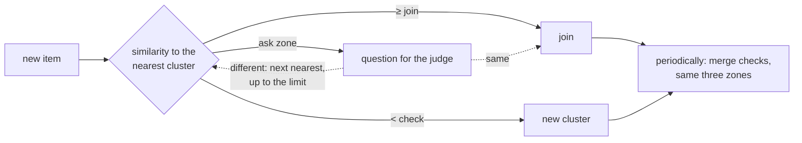

# Akinly 1.0 design

**Status:** the design record. Written as the plan for 1.0, it now describes what is built,
with the decisions and their reasons; the [guides](README.md) describe how to use it. Comments
go in the issues, and a change to this design comes in the same pull request as the code that
needs it.

- [Summary](#summary)
- [Goals and non-goals](#goals-and-non-goals)
- [What we know already](#what-we-know-already)
- [Concepts](#concepts)
- [Packages](#packages)
- [The API in three layers](#the-api-in-three-layers)
- [Options](#options)
- [Questions, answers and judges](#questions-answers-and-judges)
- [Storage](#storage)
- [Algorithms](#algorithms)
- [Tuning](#tuning)
- [Evaluation](#evaluation)
- [Performance](#performance)
- [Errors, cancellation, telemetry](#errors-cancellation-telemetry)
- [Security and privacy](#security-and-privacy)
- [Compatibility and versioning](#compatibility-and-versioning)
- [Documentation](#documentation)
- [Delivery](#delivery)
- [Key decisions](#key-decisions)

## Summary

Akinly clusters short texts as they arrive: each item joins a cluster that says the same
thing or starts a new one, clusters keep their ids for good, and clusters that turn out to
be one are merged. Similarity between embeddings decides the clear cases, and a **judge**
(a language model, local or in the cloud, or any code you write) decides the close calls.

1.0 builds a library you can drop in on top of a set of pure functions:

- **Any model.** Judges and embeddings go through `Microsoft.Extensions.AI`
  (`IChatClient`, `IEmbeddingGenerator`), so Ollama, OpenAI, Azure OpenAI, Anthropic and
  every other provider with an adapter work without Akinly knowing about them.
- **Vector databases through their connectors.** Clusters and items are kept through
  `Microsoft.Extensions.VectorData`; Qdrant and PostgreSQL with pgvector are tested, and other
  connectors work if they meet the store's few requirements (see Storage). An in-memory store
  comes in the box.
- **Questions as data.** The clusterer never has to call a model itself. It hands back the
  questions it needs answered, and takes the answers whenever they come: live, through a
  provider's batch API at half price, from a queue, or from a person.
- **Configurable.** Thresholds, limits, merges, splits, prompts and what "the same" means
  for your data are options, validated at startup, with defaults calibrated on public data.

## Goals and non-goals

**Goals**

1. Incremental, online clustering with **lasting cluster ids**: a cluster can be stored,
   linked to and shown on a page, and an item that comes back after months joins it again.
2. **Judged close calls**, with the judge pluggable and the questions available as data.
3. **Deterministic**: the same calls in the same order, with the same answers, give the same
   result, given exact nearest-neighbor search (an approximate index can return different
   candidates; see [Algorithms](#algorithms)).
4. **Provider-neutral and store-neutral**, through the two Microsoft abstractions above.
5. **Small core**: no dependencies besides Microsoft's own `Microsoft.Extensions.*`
   abstractions and options packages and `System.Numerics.Tensors`.
6. **Measured**: defaults and claims backed by reproducible results on public datasets.
7. **Documented** like a mature open-source library: guides, API reference, samples whose
   code runs in CI.

**Non-goals for 1.0**

- **Topic modeling of a fixed corpus** (find the 20 themes in this spreadsheet). Batch
  algorithms such as HDBSCAN suit that better; Akinly is for streams and lasting clusters.
- **Hosting.** No server, Docker image or HTTP API. The library runs inside your process;
  a service can be built on it.
- **Producing embeddings.** Akinly takes vectors, or calls the `IEmbeddingGenerator` you
  give it.
- **Strict multi-writer transactions over every vector database** (see [Storage](#storage)).
- **Other languages than C#/.NET.**

## What we know already

The approach comes from earlier private experiments with the clusterer in 2026, on about
11,000 one-sentence texts, embedded with
OpenAI `text-embedding-3-small` (1,024 dimensions) and judged by Claude Haiku 5.5. The data
is private, so these numbers can't be reproduced from this repository; they shaped the
design, and the [evaluation](evaluation/README.md) measures Akinly on public data. A blind referee (a larger model) graded samples; asked twice, it
agreed with itself on 25 of 30 judgments, and samples were 100 to 300 items, so differences
under about ten points are suggestive at best, not proof.

| Finding | Measurement |
|---|---|
| Embeddings capture topic well and the specific meaning only roughly | Four embedding models separated "same problem" from "different problem" with an AUC of 0.78 to 0.86; 512 to 3,072 dimensions changed nothing |
| A single threshold cannot get there | At 0.75: precision 0.32, recall 0.80; at 0.82: precision 0.54, recall 0.46. At 0.75, five clusters held 36% of all items |
| Other clustering algorithms hit the same limit | Leiden, agglomerative, UMAP with HDBSCAN: pair F1 0.39 to 0.49, against 0.50 for the threshold |
| A judge on the close calls works | Pair F1 0.68 (precision 0.84, recall 0.58); the share of items that belong on their cluster rose from 67% (cosine at 0.70) to 86% with a judge in a full run (93 to 95% in smaller offline runs; the gap was not explained) |
| The judge needs little context | The cluster's title and its ten members nearest the center did as well as the whole cluster, at a fraction of the tokens |
| Fewer questions in flight looked better | With 200 open at a time, 95% of items fit their cluster; with 1,000, 89%. Within noise, but it agrees with the reasoning: items placed while their neighbors' answers are out cannot see them |
| Questions per item are few | About 0.7 join questions and 0.4 merge questions per item, each a short prompt with ten examples; the [evaluation](evaluation/README.md) reports tokens and cost per item on public data |
| Where it still fails | Very uniform data, where every item sounds alike, grows broad clusters; 6% of items sat in a cluster that had refused them, carried there by a later merge |

The three zones (accept, ask, reject) are a long-standing pattern in record linkage
(Fellegi and Sunter, 1969) and in LLM-assisted clustering (Viswanathan et al., "Large
Language Models Enable Few-Shot Clustering", TACL 2024). What Akinly adds is the
combination: a judge deciding joins on an unbounded stream, with "start a new cluster" as a
live outcome and ids that last.

## Concepts

- **Item**: one short text, by its id, with its embedding. The text itself stays with you;
  Akinly asks for it only to put it in a judge's prompt.
- **Cluster**: a lasting id, a centroid (the normalized mean of its members), a size, and an
  optional label (a one-sentence title).
- **Zones**: an item's similarity to its nearest cluster decides what happens.

  | Zone | Similarity | Outcome |
  |---|---|---|
  | Join | at or above `JoinSimilarity` (0.83) | Joins without a question |
  | Ask | from `CheckSimilarity` (0.30) up to the join threshold | A judge picks one of the nearest clusters, or none; on "none", the next nearest are tried, up to `MaxChecksPerItem` refusals |
  | New | below `CheckSimilarity` | Starts a cluster |

- **Question**: "which of these nearest clusters, if any, does this item belong in?" (a join
  question; with one cluster offered, a yes or no) or "are these two clusters one?" (a merge
  question). Each has an id, so an answer finds it after any wait.
- **Judge**: anything that answers questions: `Same`, `Different`, `Failed` or `Unanswerable`.
- **Merge**: two clusters become one; the larger keeps its id, and the smaller's id is
  reported so you can redirect links to it.
- **Split**: a loose cluster regroups into parts. Only for cosine-only setups: when a judge
  approved each member, a similarity number should not undo it.



## Packages

| Package | What it holds | Depends on |
|---|---|---|
| `Akinly` | The clusterer, options, questions, the store and judge contracts, an in-memory store, dependency injection, the pure functions | `Microsoft.Extensions.DependencyInjection.Abstractions`, `Microsoft.Extensions.Options`, `Microsoft.Extensions.Logging.Abstractions` |
| `Akinly.AI` | `ChatClientJudge`, `ChatClientLabeler`, the prompts, `TextClusterer` (embeds texts for you) | `Akinly`, `Microsoft.Extensions.AI.Abstractions` |
| `Akinly.VectorData` | A store over any `Microsoft.Extensions.VectorData` vector store | `Akinly`, `Microsoft.Extensions.VectorData.Abstractions` |

Both Microsoft abstraction packages are stable. `Akinly.AI` uses
Microsoft.Extensions.AI.Abstractions 10.6.0 or later, and the core the Microsoft.Extensions
packages 10.0.0 or later: each package asks for the oldest version it works with, so an app
that pins the .NET 10 packages can use it. `Akinly.VectorData` uses
Microsoft.Extensions.VectorData.Abstractions 10.1.0, not a later version: the connectors available
today (Qdrant, pgvector, in-memory and others, still pre-release) are built against 10.1.0, and
10.5.0 removed types they use (`VectorSearchFilter`), as did 11.0.0. Akinly depends only on the abstractions, and you choose the connector
and its version. VectorData.Abstractions brings Microsoft.Extensions.AI.Abstractions and the
configuration abstractions with it, so `Akinly.VectorData` adds those to a project too.

Target framework: `net10.0`, the current long-term support release (.NET 8's support ended
on November 10, 2026). A `netstandard2.0` build is possible later if there is demand.

## The API in three layers

Each layer is built on the one below, and each is public, so you can stop at the level of
control you need. Layer 2 takes your item ids as strings and gives each item an internal
`long` sequence number in the store.

| Layer | Type | You provide | It does |
|---|---|---|---|
| 3. Texts in, clusters out | `TextClusterer` (`Akinly.AI`) | Texts, an embedding generator, a chat client | Embeds, places, asks the model, applies answers, until everything is settled |
| 2. Questions as data | `Clusterer` (`Akinly`) | Embeddings, a store, answers when you have them | Places items, keeps state, hands back questions, applies answers, runs merges |
| 1. Pure functions | `IncrementalClusterer` (`Akinly`) | Everything | Decides; you load and store |

### Layer 3: texts in, clusters out

```csharp
using Akinly;
using Akinly.AI;
using Microsoft.Extensions.AI;

IEmbeddingGenerator<string, Embedding<float>> embedder = /* any provider */;
IChatClient chat = /* any provider: a local Ollama model or a cloud one */;

var clusterer = new TextClusterer(embedder, chat, new ClusteringOptions
{
    EmbeddingModel = "text-embedding-3-small",
});

await clusterer.AddAsync(
[
    new TextItem("t1", "My landlord won't fix the heating"),
    new TextItem("t2", "The heat has been out for weeks and the landlord ignores me"),
    new TextItem("t3", "I can't find an apartment I can afford"),
]);

await foreach (var cluster in clusterer.ListClustersAsync())
{
    Console.WriteLine($"{cluster.Id}: {cluster.Count} items");
}
```

`TextClusterer` keeps the texts it was given in an `IItemTextStore` (in memory by default; your
own over a database works the same) so its judge and labeler can quote them, and
`ForgetTextAsync(itemId)` drops one. Its calls run one at a time; `SettleAsync` resumes after an
interrupted add.

### Layer 2: questions as data

```csharp
var clusterer = new Clusterer(store, options);

// Place new items. Clear cases are settled at once; close calls come back as questions.
ClusteringStep step = await clusterer.AddAsync(items, cancellationToken);

// Answer them now, or in an hour from a batch: answers are matched by question id.
IReadOnlyList<Verdict> verdicts = await judge.JudgeAsync(step.Questions, cancellationToken);
step = await clusterer.AnswerAsync(verdicts, cancellationToken);   // may hold follow-up questions

// Every so often: compare changed clusters for merges (and splits, when configured).
step = await clusterer.MaintainAsync(cancellationToken);
```

```csharp
public sealed record ClusterItem(string Id, ReadOnlyMemory<float> Embedding);

public sealed record ClusteringStep(
    IReadOnlyList<Placement> Placements,   // item → cluster, and why (similarity, judge, new cluster)
    IReadOnlyList<ClusterMerge> Merges,    // from → into, so you can redirect links
    IReadOnlyList<ClusterSplit> Splits,    // cosine-only setups
    IReadOnlyList<Question> Questions);    // asked in this step

public sealed class Clusterer
{
    public Clusterer(IClusterStore store, ClusteringOptions options, ILogger<Clusterer>? logger = null,
        IMergePolicy? mergePolicy = null);

    public Task<ClusteringStep> AddAsync(IEnumerable<ClusterItem> items, CancellationToken cancellationToken = default);
    public Task<ClusteringStep> AnswerAsync(IEnumerable<Verdict> verdicts, CancellationToken cancellationToken = default);
    public Task<ClusteringStep> MaintainAsync(CancellationToken cancellationToken = default);
    public Task RemoveAsync(IEnumerable<string> itemIds, CancellationToken cancellationToken = default);
    public Task<bool> SetLabelAsync(long clusterId, string? label, CancellationToken cancellationToken = default);

    public Task<IReadOnlyList<Question>> GetOpenQuestionsAsync(CancellationToken cancellationToken = default);
    public Task<Cluster?> GetClusterAsync(long clusterId, CancellationToken cancellationToken = default);   // follows merges
    public IAsyncEnumerable<Cluster> ListClustersAsync(CancellationToken cancellationToken = default);
    public Task<IReadOnlyList<string>> GetMembersAsync(long clusterId, CancellationToken cancellationToken = default);
    public Task<long?> GetClusterOfAsync(string itemId, CancellationToken cancellationToken = default);
}
```

`SettleAsync(this Clusterer, IEnumerable<ClusterItem>, IClusterJudge)` loops add, judge and
answer until no question is left, for callers that answer live.

`RemoveAsync` takes items out (their source was deleted, say) and recomputes their
clusters' centroids. A cluster left empty keeps its id and its last centroid, so a returning
item can still join it at the join threshold (with no members to show, a judge is never asked
about it); its sum restarts from that member.

A call that finds items waiting for room to ask (after a removal, say) lets them in first.
`SettleAsync` loops until no question is open and nothing waits.

### Layer 1: pure functions

`IncrementalClusterer`, `Vectors` and their records are public and supported, as
low-level building blocks; the clusterer uses `TrySplit` from them, and keeps its own logic
for placement and merges because it works on sums and through a store. Ids stay `long` there.
`ReadOnlySpan<float>` overloads were tried and left out: next to the `float[]` ones they make
calls with collection expressions (`Vectors.Dot([1f, 0f], ...)`) ambiguous.

### Dependency injection

```csharp
services.AddAkinly(options => options.EmbeddingModel = "text-embedding-3-small")   // or AddAkinly(configuration.GetSection("Akinly"))
    .UseInMemoryStore()                    // or .UseVectorStore(...), from Akinly.VectorData
    .UseChatClientJudge()                  // from Akinly.AI; uses the IChatClient in the container
    .AddChatClientLabeler()                // from Akinly.AI
    .AddTextClusterer();                   // from Akinly.AI; uses the IEmbeddingGenerator in the container
```

Options bind from configuration (`Akinly` section) and are validated at startup
(`ValidateOnStart`): an invalid threshold fails the host, not the first request.

## Options

`ClusteringOptions`, with the thresholds calibrated for `text-embedding-3-small` at its default
dimensions, with `akinly-eval calibrate`, on 6,000 texts pooled from the training splits of
Banking77, CLINC150 and MASSIVE (287 groups). The ask zones are wide on purpose: the judge,
not similarity, decides the close calls, and `MaxChecksPerItem` bounds the questions per item.
Thresholds never shift at run time.

| Option | Default | What it does |
|---|---|---|
| `JoinSimilarity` | 0.83 | At or above it, an item joins without a question |
| `CheckSimilarity` | 0.30 | At or above it (and below the join threshold), a judge decides. Set it equal to `JoinSimilarity` for cosine-only clustering |
| `MaxChecksPerItem` | 3 | Refusals an item takes before it starts its own cluster; a "none" to a question with choices counts one for each cluster offered |
| `JoinChoices` | 3 | Clusters offered in one join question, nearest first; 1 asks yes or no about the nearest |
| `MaxOpenQuestions` | 200 | Questions in flight at once; new items wait while it is reached. Lower is more accurate, higher is faster |
| `CandidateClusters` | 10 | Nearest clusters fetched when placing an item (the nearest few are offered to the judge, up to `JoinChoices`; the rest stand in when they are empty or refused the item) and for each cluster in a merge check |
| `MaxClustersPerMaintain` | 1,000 | Changed clusters one `MaintainAsync` checks; the next call continues after the last one checked, wrapping around, so every changed cluster gets its turn |
| `MergeSimilarity` | 0.72 | At or above it, two clusters merge without a question |
| `MergeCheckSimilarity` | 0.55 | At or above it (and below the merge threshold), a judge decides |
| `MergeRefusals` | `Ask` | When one cluster already refused an item in the other, a judge decides; the pair is never merged on similarity alone (`Block` never merges it, `Ignore` disregards the refusal; [why](#algorithms)) |
| `MergeLinkage` | `Average` | Two clusters' similarity is the average similarity of their members, not of their centroids ([why](#algorithms)) |
| `ExamplesPerQuestion` | 10 | Members nearest the center shown to the judge with a join question |
| `MergeExamplesPerCluster` | 8 | Members of each cluster shown with a merge question |
| `FailedAnswers` | 3 attempts, 1 s apart, doubling up to 5 minutes while every answer fails | A `Failed` answer never counts as a refusal: the question stays open and is asked again (the item waits). After the last attempt, a join is decided by similarity alone, and a merge pair is left unrecorded, so it is asked again once either cluster changes. `SettleAsync` waits `RetryDelay` after a round in which every answer failed |
| `Split` | off | Cohesion threshold, regroup similarity and minimum part size. Cosine-only setups only: refused by validation when the options have an ask zone |
| `EmbeddingModel` | required | The model the embeddings come from. The store records it, and a clusterer configured with another model refuses to run on that store, because thresholds do not carry over. Each item's dimensions are checked too |

`ClusteringOptions.CosineOnly(embeddingModel, joinSimilarity, mergeSimilarity?)` is a preset
with no ask zone, no judge needed.

## Questions, answers and judges

```csharp
public abstract record Question(QuestionId Id, double Similarity);
public sealed record JoinQuestion(QuestionId Id, string ItemId, long ClusterId, double Similarity,
    string? ClusterLabel, IReadOnlyList<string> ExampleItemIds) : Question(Id, Similarity)
{
    public IReadOnlyList<JoinChoice> OtherChoices { get; init; } = [];   // the next nearest; empty for yes or no
}
public sealed record JoinChoice(long ClusterId, double Similarity, string? ClusterLabel, IReadOnlyList<string> ExampleItemIds);
public sealed record MergeQuestion(QuestionId Id, long ClusterId, long OtherClusterId, double Similarity,
    string? ClusterLabel, string? OtherClusterLabel,
    IReadOnlyList<string> ExampleItemIds, IReadOnlyList<string> OtherExampleItemIds) : Question(Id, Similarity);

public enum VerdictKind { Same, Different, Failed, Unanswerable }
public readonly record struct Verdict(QuestionId QuestionId, VerdictKind Kind)
{
    public long? ClusterId { get; init; }   // the cluster picked from a join question's choices
    public static Verdict Picked(QuestionId questionId, long clusterId);   // Same, for that cluster
    // Same, Different, Failed and Unanswerable build the other answers.
}

public interface IClusterJudge
{
    Task<IReadOnlyList<Verdict>> JudgeAsync(IReadOnlyList<Question> questions, CancellationToken cancellationToken);
}
```

A question carries everything a judge needs except the texts: the cluster's label and the ids
of its members nearest the center. `Unanswerable` is for a question that cannot be put at all
(an item's text is gone): it closes at once, and similarity alone decides.

**Join questions with choices.** A join question offers up to `JoinChoices` of the item's
nearest clusters with members, nearest first. The nearest must be in the ask zone; the others
come with it as context, whatever their similarity. The judge picks one (`Verdict.Picked`;
`Same` is the nearest) or none (`Different`), and "none" is a refusal by every cluster
offered. A pick of a cluster that was not offered counts as a failed answer. Shown its
neighbors side by side, a judge sees how fine the clusters are: in development runs with a
perfect judge (the labels answering), choices reached the same quality with 25 to 35% fewer
questions than yes-or-no questions.

Rules the clusterer keeps:

- **Applied once.** An answer to a question that is already answered, or unknown, is
  ignored; answers can arrive in any order and more than once. An answer can only reach a
  question that existed when the call began.
- **Ordered within a call.** The answers given to one `AnswerAsync` call are applied in
  question order, whatever order they are listed in. Across calls, the result depends on
  which answers came in which call, as it depends on the order of `AddAsync` calls.
- **A late yes is checked.** A merge answered "same" is applied only if the two clusters
  are still within the merge-check zone when the answer arrives, so a chain of yeses cannot
  fold distant clusters together. A join answered "same" for a cluster that has since been
  merged away is put to the cluster it merged into, if the item is within that cluster's
  check zone and no cluster that refused the item merged into it; otherwise the item is
  placed again. A cluster picked from the choices is treated the same way.
- **Refusals follow merges.** An item never joins, or is asked about, a cluster that
  refused it, even after that cluster merged into another.
- **Waiting is safe.** An item with an open question stays unplaced; other items keep being
  placed, up to `MaxOpenQuestions`.

**Judges in the box**

- `ChatClientJudge` (`Akinly.AI`): asks any `IChatClient`, several questions in parallel
  (`MaxParallelRequests`, default 4), with a JSON answer (`{"same": true}`, or
  `{"group": n}` for a join question with choices, 0 for none) through structured output where
  the provider supports it. The prompts are options (`JoinInstructions`, `ChoiceInstructions`,
  `MergeInstructions`), and `Criterion` says what "the same" means for your data. The merge
  prompt calls two clusters one when a typical member of one would fit just as well in the
  other; a few odd members do not matter. The choice prompt says the groups were picked only
  because they look similar, and asks for a group only if the new text asks for the same
  specific thing as its members. `Preference` (`ClusteringPreference`: `Balanced`, `Precision`
  or `Recall`) adds a tie-break sentence after the instructions: when unsure, keep apart, or
  put together. The default, "about the same specific problem or request, so that one answer or
  fix would settle both", fits feedback and complaints; "asking the same question" or
  "describing the same bug" fit other data. Texts go into the prompt as JSON strings, so an
  item cannot break out of its quotes. Requests carry no tools and no conversation state,
  time out after `RequestTimeout`, and send no temperature unless you set one or turn on
  `UseZeroTemperature` (off by default: current Claude models and OpenAI's reasoning models
  reject any temperature). An answer is read even after a model's reasoning. Every failure (the
  model, a timeout, the text store, an unreadable answer) is `Failed`; a question with nothing
  fair to show (the item's text is gone, or the cluster has neither a member's text nor a
  label) is `Unanswerable`. `IncludeLabels` can keep labels out of the prompts.
- `DelegateJudge`: wraps a function, for rules or tests.

**Batch APIs.** `JudgePrompts.BuildRequestsAsync(question, texts)` returns the requests
`ChatClientJudge` would send (one for a join question, one per member asked each way for a
merge question), and `JudgePrompts.ReadVerdict(question, requestCount, answers)` the verdict from their
answers in any order. `BuildAsync` builds one prompt (`BuildJoin`, `BuildChoice` and
`BuildMerge` take texts you already have), `JudgePrompts.CreateRequestOptions(options, choice)` the options it sends them
with, and `JudgePrompts.TryParse(text, out bool same)` or, for a question with choices,
`JudgePrompts.TryParseChoice(text, count, out int group)` reads an answer. Send the messages through a provider's batch API, then pass the verdicts to
`AnswerAsync` when the batch ends. No live connection is needed.

**Labels.** A cluster's label goes into its join questions, which helps the judge see what
a reader would see. `ChatClientLabeler` writes one at a configurable size and again each
time the cluster doubles or halves; you can also set labels yourself with `Clusterer.SetLabelAsync`.

## Storage

```csharp
public interface IClusterStore   // namespace Akinly.Storage
{
    Task<StoreInfo> GetInfoAsync(CancellationToken cancellationToken);   // version, model, counters
    Task<IReadOnlyList<ClusterNeighbor>> NearestClustersAsync(ReadOnlyMemory<float> vector, int count, CancellationToken cancellationToken);
    Task<IReadOnlyList<StoredCluster>> GetClustersAsync(IEnumerable<long> ids, CancellationToken cancellationToken);
    IAsyncEnumerable<StoredCluster> ListClustersAsync(CancellationToken cancellationToken);
    Task<IReadOnlyList<StoredCluster>> GetChangedClustersAsync(long afterId, int count, CancellationToken cancellationToken);
    Task<IReadOnlyList<StoredItem>> GetItemsAsync(IEnumerable<string> ids, CancellationToken cancellationToken);
    Task<IReadOnlyList<StoredItem>> GetMembersAsync(long clusterId, CancellationToken cancellationToken);
    Task<IReadOnlyList<string>> GetExamplesAsync(long clusterId, int count, CancellationToken cancellationToken);
    Task<IReadOnlyList<StoredItem>> GetWaitingItemsAsync(int count, CancellationToken cancellationToken);
    Task<IReadOnlyList<StoredQuestion>> GetQuestionsAsync(IEnumerable<QuestionId> ids, CancellationToken cancellationToken);
    Task<IReadOnlyList<StoredQuestion>> GetOpenQuestionsAsync(CancellationToken cancellationToken);
    Task<IReadOnlyList<MergeCheck>> GetMergeChecksAsync(IEnumerable<(long ClusterId, long OtherClusterId)> pairs, CancellationToken cancellationToken);
    Task ApplyAsync(ChangeSet changes, long expectedVersion, CancellationToken cancellationToken);
}
```

The reads are narrow on purpose, so a database store can answer each with one indexed query.
Records are whole and immutable (`StoredCluster`, `StoredItem`, `StoredQuestion`,
`MergeCheck`, `StoreInfo`); a change set upserts them by id.

The clusterer reads what it needs, computes a `ChangeSet` (new and changed clusters,
memberships, questions, refusals, merges), and writes it with one
`ApplyAsync`. A store keeps a version number in its metadata; a store that can compare and
swap it (the in-memory store, a transactional database) makes `ApplyAsync` an
optimistic-concurrency write: if another writer got there first, it throws
`ClusterStoreConflictException`, and the clusterer reads again and recomputes.

| Store | Atomic `ApplyAsync` | Use it for |
|---|---|---|
| `InMemoryClusterStore` | Yes (one lock) | Tests, jobs that fit in memory (exact search scans every cluster, so tens of thousands of clusters at most), a snapshot you save yourself (`ExportAsync`/`ImportAsync` as JSON, validated on import) |
| `VectorDataClusterStore` | No: journaled, one writer | A vector database through its connector (Qdrant and PostgreSQL with pgvector are tested) |

Vector databases mostly offer neither transactions across collections nor compare-and-swap,
so `VectorDataClusterStore` supports **one writer at a time** (run the clusterer on one
instance, or behind a lock of your own) and makes a stopped write recoverable with a journal:

1. Before anything is written, the change set is checked for what a database could not
   store, and refused whole with an `ArgumentException` or `EmbeddingModelMismatchException`:
   vectors of the wrong length, ids and labels with a NUL character or an unpaired surrogate,
   and the same record twice.
2. The whole change set goes to the journal: its JSON in parts of 512 KB, then a header
   record with the version it moves to and its schema version, written last, so a journal is
   complete or absent. A change set of metadata only is one record and skips the journal.
3. Its writes follow, a page at a time, each an upsert by id, so applying it twice changes
   nothing.
4. The metadata record's version moves last, and the journal is deleted (header first).

Before its first write, and after any write that failed, the store finishes a journaled
change set whose version is newer than the metadata's. If that fails too, every write stops
with an `InvalidOperationException` naming the change set, so nothing is ever computed from
half-written data: fix the cause (the database unreachable, out of space, refusing a
permission) and write again. The checks above keep a change set's own data from being the
cause; were it ever, deleting the metadata records whose `Name` starts with `journal` drops it.
Every write looks for a journal first (one read), so it also finishes one another process left.
A change set too large to journal in one piece (some hundreds of thousands of long vectors) is
refused with an `ArgumentException`: add fewer items per call. Parts of a journal stopped
before its header was written stay behind until a later journal overwrites them; they are
never read.
Reads do not recover: while a write is under way, or between a failed write and the next one,
a reader can see part of a change set (an item placed in a cluster whose count has not moved
yet). A transactional store (EF Core, for one) can offer strict multi-writer safety and
consistent reads later behind the same interface.

A connector works if its database:

- shows each write to the next read at once (read-your-writes): the version check reads the
  metadata the last write left, and a database that indexes in the background (Azure AI
  Search) could let a write pass over the one before it;
- supports filtered reads with ordering (`GetAsync` with a filter and `OrderBy`), and
  filtered vector search;
- accepts the key kind chosen (below).

Qdrant, PostgreSQL with pgvector and the in-memory connector meet them and are tested; others
are not tested.

The store keeps five collections, named `{CollectionPrefix}{NameSeparator}{name}`: clusters
(centroid, sum, size, label), items (embedding, cluster id, refusals), questions, merge
checks, and metadata (the store's info with its schema version, and the journal). Nearest
clusters come from the database's own index; examples are the cluster's items nearest its
centroid. Connectors that require a vector on every record get a one-dimension placeholder
in the last three. A store written by a newer schema version is refused, not misread.

Connectors differ in the key types they accept: Qdrant takes `ulong` or `Guid`, Azure AI
Search and Redis take `string`. The store maps every id to one key kind
(`VectorDataClusterStoreOptions.KeyKind`): name-based UUIDs (version 5, the default) or text
keys such as `cluster-42`, made only of letters, digits, `-` and `_` (an item's id, which can
hold any character, is written in base64url, or hashed with SHA-256 when it is over 300 bytes,
since keys are limited: 1,024 characters in Azure AI Search, about 2,700 bytes in a PostgreSQL
index), keeping the original ids in data fields.

Merged clusters stay in the clusters collection with `Live = false`, so searches filter on it.
Records keep what not every database stores natively as text: refusal lists and questions as
JSON, sums as base64 of their little-endian doubles (exact, and a third of the size of JSON).
The collections are made with `VectorDataClusterStoreOptions.Dimensions`, which is required.
Similarities are recomputed from the returned vectors, so the index's distance function only
decides which candidates come back, and the search asks for a few more than needed
(`SearchOversampling`) to make up for an approximate index. Examples ask for at least one
more than needed: when the last one taken ties with the next (duplicate texts), or the search
comes back with fewer than the cluster could fill (an index that filters after its scan), the
store reads all the cluster's members and ranks them itself, ties by sequence, as the
in-memory store does.

The default distance function is the dot product. Akinly's vectors are unit length, so it ranks
as cosine does, and the database keeps vectors exactly as written: Qdrant normalizes vectors
stored for cosine, and the rounding would make sums drift as members leave.

Reads page by key (`ClusterId > last`, `Sequence > last`), never by offset, so each page costs
the same however deep the read goes. `PageSize` (default 100) bounds every page, lookup by key
and write; pages of records with vectors are also kept under about 2 MB, so with long vectors
they hold fewer (clusters of 3,072 dimensions: 42), within Qdrant's 4 MB gRPC message limit.

Two database behaviors to know:

- **Qdrant** compares numbers in range filters as doubles, so ids and sequences are exact up
  to 2^53, far more than any store hands out.
- **PostgreSQL with pgvector** filters an HNSW search after the index scan, so a filtered
  search (examples of one cluster, live clusters only) can return fewer results than asked
  for when the matching rows are a small fraction of the table. Use an exact index
  (`IndexKind.Flat`: no index, a full scan) or raise `hnsw.ef_search`; pgvector
  0.8's iterative scans (`hnsw.iterative_scan`) also fix it.

The contract tests run the same scenarios against the in-memory reference store and against
each database (the in-memory connector always; Qdrant and PostgreSQL with pgvector in
containers), and the results must be identical, down to the bits of every vector and sum: a
scripted run with UUID and text keys; a harder one with merges, waiting items, a maintenance
cursor that wraps, duplicate embeddings and unusual ids, with one record per page and no
oversampling; ties among examples; ids up to 2^53 and ids too long to be keys; 1,100 clusters
of 1,536 dimensions; a write stopped after each of its steps, journals of one part and of
several, then finished by the next write in the same process or a new one; two writes at
once; text no database can store; and stores and journals from a newer schema.

## Algorithms

The clusterer keeps the behavior of the unpublished pre-1.0 functions, with these changes:

1. **Centroids from sums.** The earlier running mean renormalizes after each member, which
   reweights members slightly; a test pins down that it is close, not equal, to the true
   mean. 1.0 keeps each cluster's sum of unit-length members in double precision and
   derives the centroid from it, so the centroid is the mean direction up to rounding,
   merges add sums, and removing a member subtracts it. `MaintainAsync` recomputes a
   cluster's sum from its members after many removals, so rounding cannot build up.
2. **Refusals bear on merges, and a judge decides.** In the earlier experiments, 6% of items
   ended up in a cluster that had refused them, carried there by a later merge, so 1.0
   skipped such merges. On texts written to one template that blocked most merges that
   mattered: a "none" to three choices refuses all three clusters, and on 3,000 statements of
   the complaints development set, 86 of 127 pairs of clusters with centroids at 0.88 or more
   were never asked about. 1.1 leaves such
   pairs to a judge (`MergeRefusals = Ask`): never merged on similarity alone, always asked.
   `Block` keeps the 1.0 behavior. Allowing those merges is safe only with the next change.
3. **Clusters compared by their members.** 1.0 compared two clusters by their centroids. A
   centroid averages away what sets its members apart and keeps what they share, so on texts
   written to one template it drifts toward every other centroid as a cluster grows mixed: on
   need statements written from public complaints, two clusters of 50 unrelated statements
   scored 0.98 by their centroids, above 1.0's merge threshold of 0.96, against 0.47 for the
   average similarity of their members. Refusals had been hiding this; with them out of the
   way, merges snowballed into a handful of catch-all clusters. Many of the "near-identical"
   pairs above were such mixed clusters. 1.1 compares clusters by the average similarity of a
   member of one to a member of the other (`MergeLinkage = Average`), the dot product of their
   sums over the product of their sizes: no extra reads, equal to the cosine for single items,
   and it does not rise as clusters grow mixed. Neighbors are still found by their centroids.
4. **Candidates from the store.** Each item is compared with its `CandidateClusters` nearest
   clusters from the store's index, not with every cluster, and merge checks cover only
   clusters that changed since the last `MaintainAsync`, with their nearest neighbors. The
   pair-based `FindMerges` already guarantees the same decisions as the all-pairs check
   whenever the close pairs are among the candidates.
5. **Settled pairs stay settled.** A pair a judge called different, and the parts of a split,
   are recorded, so a later certain merge does not undo the decision. `RefusedBy` lists only
   grow (an item's removal does not lift its refusal): conservative, and cheap to keep.
6. **Your rules for merges.** An optional `IMergePolicy` is asked about each pair before a
   merge, certain or judged, and before a merge question: `Never` keeps the pair apart (for
   clusters of different tenants or languages, or a pair a person separated) and costs no
   question; `KeepFirst` or `KeepSecond` chooses which keeps its id (for a cluster with a
   public address); `Allow` leaves the default, the larger. It sees only the clusters; you look
   up what you know about them by id.

Placement within one call stays in input order; an item can join a cluster formed earlier
in the same call. Results are reproducible for the same sequence of calls and answers when
nearest clusters come from an exact search (the in-memory store, or a database configured
for exact search). An approximate index (HNSW, IVF) can return slightly different
candidates from run to run, and so slightly different clusters.

## Tuning

Thresholds belong to an embedding model: cosine similarities from two models are not on
the same scale. The defaults are for `text-embedding-3-small` at its default dimensions; with
another model:

1. Run `akinly-eval calibrate` (`tools/Akinly.Evaluation`) on labeled data close to yours: a
   JSON-lines file of `{"id", "text", "label"}`, or the training split of Banking77,
   CLINC150 or MASSIVE (News-T and Tweets-T have no split and are read whole). It replays the items in a random order into clusters made from their labels (what
   a perfect clusterer would build), comparing each item with every cluster so far before it
   joins its own: so it meets clusters of every size, and sometimes its own group has none yet,
   as early in a stream. For merges, it cuts each group in two, a fragment of one to five
   items and the rest (what the clusterer leaves apart in practice: a few items that came
   early or were refused, rarely half a group), and compares every part with every other.
2. It suggests `JoinSimilarity`, the lowest similarity at which the nearest cluster is the
   item's own at least 95% of the time (fitted as rising with similarity, so a band of mostly
   wrong candidates is not hidden by the many easy ones above it); `CheckSimilarity`, which
   keeps 99% of the items a judge would see (their own cluster among the `MaxChecksPerItem`,
   five, nearest) within its reach; and the merge thresholds from every pair of parts, since
   maintenance merges every pair above the threshold in time (the merge check keeping 99% of
   the true pairs among each other's ten nearest), with tables of how often candidates are
   right at each similarity. Join and merge thresholds are rounded up, check thresholds down.
   Besides the balanced values (95% right without a question), it gives a set that prefers
   precision (98%) and one that prefers recall (90%), with the same check thresholds, to pair with the
   judge's `Preference`.
3. Check the result on a sample of whole clusters, not pairs: the question that matters
   is whether a cluster's label honestly describes every member.

The defaults are calibrated for OpenAI's `text-embedding-3-small`; the [evaluation](evaluation/README.md)
also calibrates `qwen3-embedding:8b` on each dataset, and the calibration tool does it for any model.

## Evaluation

Claims about Akinly rest on public data that anyone can rerun.

- **Datasets**: Banking77 (CC BY 4.0: 10,003 training and 3,080 test customer-service
  questions in 77 intents) and CLINC150 (CC BY 3.0: 15,000 training and 4,500 test queries
  in 150 intents; its out-of-scope queries are left out, since they share no group). Both
  are downloaded by the tool from a fixed commit, checked against their SHA-256, and never
  committed. Short texts with known groups, close to Akinly's use: many intents share a topic
  and differ in the specific request. The tool also knows MASSIVE's English intents (CC BY 4.0)
  and the short-text stream sets News-T and Tweets-T (Yin et al., 2018; no license stated, so
  they are downloaded for evaluation only and never redistributed).
- **Splits**: thresholds are calibrated on a sample of the training split, and the whole test
  split is clustered. Both splits hold the same intents, so the calibration knows the domain:
  closer to tuning on your own past data than to starting cold.
- **Setups**: cosine only at the threshold that scores best on the test labels (an optimistic
  baseline: in practice you have no labels to tune on), cosine only at the calibrated join and
  merge thresholds (no judge, no tuning on the test labels), and Akinly with a judge at the
  calibrated thresholds. The judge can be a local model or a cloud one, and its failed answers
  are counted and reported, so a row where the judge was mostly down cannot pass for a judged
  one. A batch algorithm (agglomerative clustering or HDBSCAN) is left out: it answers a
  different question, since it sees all items at once and keeps no ids.
- **Measures**: adjusted Rand index and normalized mutual information (with the arithmetic
  mean, which equals V-measure) against the labels; pairwise precision, recall and F1;
  clusters; and for the judged setup, questions and tokens per item and the share of failed
  answers.
- **Stream order**: an incremental clusterer depends on order. `akinly-eval evaluate` feeds
  items in several seeded orders and reports the spread; the published 1.0 results use one
  shuffled order per setup (and the file order for the stream sets), for cost.
- **Reporting**: [docs/evaluation](evaluation/README.md) has the results, the commands to
  rerun them, and published results for context; the README shows the headline numbers.

## Performance

- Placement is O(items × `CandidateClusters`) given the store's index; the in-memory store
  uses a flat scan with SIMD (`System.Numerics.Tensors`); for large stores, use a database's
  vector index through `Akinly.VectorData`.
- No allocation per comparison: vectors are `ReadOnlyMemory<float>`, compared with
  `TensorPrimitives.CosineSimilarity` or a dot product on normalized vectors.
- `benchmarks/Akinly.Benchmarks` (BenchmarkDotNet) measures nearest-cluster search, adding a
  batch and a maintenance pass on the in-memory store at increasing sizes, on data with
  structure (half of each batch joins a cluster; one cluster in ten has a twin to merge with),
  and checks that the data still does so before measuring. Run it on your own hardware; times
  depend on it.
- In practice the judge dominates: a model call takes far longer than placing thousands of
  items, which is why the number of questions per item is part of the evaluation.

## Errors, cancellation, telemetry

- Every async method takes a `CancellationToken`, and library code awaits with
  `ConfigureAwait(false)`.
- Invalid arguments throw `ArgumentException`s at the call; invalid options fail at startup.
  `EmbeddingModelMismatchException` (another model's store, or an embedding of the wrong
  length) and `ClusterStoreConflictException` (another writer won, 16 times in a row) cover
  the rest. A conflict is retried after a short random backoff.
- A judge's failure never throws through the clusterer: it is a `Failed` verdict, handled
  per `FailedAnswers`. An outage therefore delays placement; it never turns into refusals
  that would split clusters or block merges.
- Telemetry through `System.Diagnostics`: an `ActivitySource` and a `Meter` named
  `Akinly`, with counters for items placed (by reason), questions, verdicts, merges, splits
  and store conflicts, and a histogram of operation duration. Logging through `ILogger` with source-generated messages.
  No telemetry or log entry carries an item's text, and metric tags are low-cardinality
  words, never ids.

## Security and privacy

- **Text stays with you.** The clusterer and stores keep ids and vectors. Text is read
  only through `IItemTextSource`, to build a judge's prompt, and is never logged or put in
  an exception. A source that has forgotten an item's text returns null, and the item is
  placed by similarity alone. Embeddings are not anonymous, though: research has recovered
  much of a text from its embedding, so a vector database holding them deserves the same
  care as the texts.
- **Prompt injection.** An item's text is quoted inside prompts, so an item can try to
  steer the model ("answer yes"). It can reach a join question, a merge question (where one
  yes folds two whole clusters together) and a label, and a label is shown to readers and
  quoted in later questions. Mitigations: prompts fence item text as data (an item cannot
  break out of its quotes, though a model can still be swayed by what it says); the judge
  answers only same or different through structured output; a label is rejected if it holds
  braces, quotes, control characters or line breaks of any kind, and `IncludeLabels` can keep
  labels out of prompts; and the requests of `ChatClientJudge` and `ChatClientLabeler` carry
  no tools and no conversation state (middleware you add to the chat client can still change
  a request). The worst an injected item can do is bend clusters and labels: a quality
  problem, never code execution or data access. Review labels before showing them publicly.
- **Supply chain.** Locked restores, audited packages, pinned actions, CodeQL, symbol
  packages mapped to the sources by Source Link, Trusted Publishing to nuget.org.

## Compatibility and versioning

- Semantic Versioning: a breaking change to the public API comes only in a major version, and the changelog says what changed.
- From 1.0, `Microsoft.CodeAnalysis.PublicApiAnalyzers` tracks every public member in
  `PublicAPI.Shipped.txt`, and package validation compares each release with the last one,
  so a breaking change cannot ship by accident.
- Interfaces meant for others to implement (`IClusterJudge`, `IClusterStore`,
  `IItemTextSource`) change only in a major version; new capabilities arrive as new
  interfaces.
- The store's data format carries a schema version, and a newer Akinly reads every older
  one.

## Documentation

- Guides in `docs/`, indexed in [docs/README.md](README.md):
  - **Getting started**: install, the first clusterer, reading results, persisting.
  - **Concepts**: zones, questions, refusals, merges, splits, lasting ids, the store, determinism.
  - **Configuration**: every option, with its default and when to change it.
  - **How-to guides**: Ollama, OpenAI and other providers, cosine only, answering questions
    yourself or in a batch API, merge policies, Qdrant, pgvector, labels, removals,
    calibrating thresholds, dependency injection, telemetry, saving the in-memory store.
  - **Troubleshooting** and **FAQ**.
- A README for each package, shown on nuget.org.
- **API reference** in the XML comments (every public member has one; the build fails
  otherwise), which IDEs show.
- **Evaluation**: the results, how they were measured, how to rerun them (`docs/evaluation`).
- No sample projects: the examples live in the guides. Those that need only the core package
  run as tests (`ReadmeExampleTests`, `DocsExampleTests`); those that need a model or a
  database are checked against the APIs by hand.

## Delivery

Akinly was built in milestones (the clusterer; `Akinly.AI`; `Akinly.VectorData`; the evaluation and
calibration tools; the documentation and public API tracking; the quality work) and released
first as 1.0.0. No 0.x version was published.

## Key decisions

| Decision | Why | Rejected |
|---|---|---|
| Item ids are strings; cluster ids are `long`, handed out by the store in order | Callers keep their own ids; sequential cluster ids keep results deterministic and fit in a URL | Generic ids (every store must handle any key type); GUIDs (random, so not deterministic) |
| Three packages: `Akinly`, `Akinly.AI`, `Akinly.VectorData` | The core carries no model or database dependency; you install only the adapters you use | One package, which would pull both abstractions into every project |
| `net10.0` only | The one long-term support release still supported, with modern C# and `System.Numerics.Tensors` throughout | Adding `netstandard2.0` (polyfills, `#if` branches, slower vector math); possible later on demand |
| `VectorDataClusterStore` supports one writer, with a journal for crash recovery | Vector databases can't promise atomic writes or compare-and-swap across collections, and a guarantee that differs per database is no guarantee | Best-effort optimistic writes on databases that allow them |
| Splits off by default, refused with a judge | A judge approved each member; a similarity number should not undo that | Splits always allowed; splits on by default for cosine-only setups |
| Default thresholds calibrated for `text-embedding-3-small` on public data (6,000 texts from Banking77, CLINC150 and MASSIVE), calibrated values for other models in the guide | Anyone can reproduce them with the calibration tool; a model-specific table is honest about the dependence | No defaults (more setup before a first run); defaults guessed for a local model |
| Wide ask zones, bounded by `MaxChecksPerItem` | The judge, not similarity, decides the close calls; only decisions made without a question must be nearly always right | Narrow ask zones that leave more to similarity |
| Join questions offer the nearest clusters as choices (`JoinChoices`, 3) | Shown neighboring clusters, the judge sees how fine they are; with a perfect judge, the same quality with fewer questions | Yes-or-no questions only (still available with `JoinChoices` = 1) |
| A preference is a prompt tie-break plus a matching threshold set, fixed at run time | Which mistake is cheaper depends on the use; fixed thresholds keep results reproducible | Thresholds that shift at run time |
| First evaluation on Banking77 and CLINC150 | Short texts, intents that share a topic but differ in the request, permissive licenses, about 37,000 texts | MTEB's clustering tasks from the start; they can follow after 1.0 |
